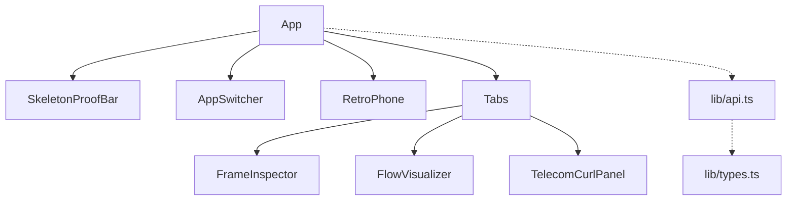

# Design: Retro Simulator

## Stack
React 19 + Vite + TypeScript (strict) + Tailwind CSS v4 through `@tailwindcss/vite`
(v4 needs no `tailwind.config.ts`; design tokens live in `src/index.css`).
In development Vite proxies `/api` and `/ussd` to `http://127.0.0.1:8000`. In production
`npm run build` emits `frontend/dist/`, which FastAPI serves on the same port.

## Component tree

## State (in `App.tsx`)
| State | Type | Purpose |
| --- | --- | --- |
| `apps` | `UssdApp[]` | From `/api/apps`. |
| `activeId` | `string` | Selected app. Theme CSS variables are derived from it. |
| `sessionId` | `string` | `crypto.randomUUID()` per dial. |
| `frame` | `UssdFrame \| null` | Last JSON frame. |
| `history` | `HistoryEntry[]` | Inputs and frames for the inspector. |
| `visited` | `string[]` | Node ids visited in the session, for the tree. |
| `metrics` | `Metrics \| null` | Polled every 10 s. |

## Data flow
1. Dial: new `sessionId`, `POST /ussd` JSON `{session_id, app_id, phone_number, text: preset or "", input_mode: "cumulative"}`.
2. Send: `POST /ussd` JSON `{..., text: input, input_mode: "step"}`.
3. The webhook tab sends form data `sessionId, serviceCode, phoneNumber, text` and displays the text/plain answer.

## Theming
`App` sets CSS variables on the root element from `theme`. Components only use
`var(--...)` through Tailwind arbitrary values, so a new app restyles the whole UI.

## Visual language (GhostSignal)
- Dark lab background, phone bezel from `theme.bezelColor`.
- LCD: `theme.screenBg` / `theme.screenText`, monospace, scanline overlay, soft glow.
- Blinking 2G LED, signal bars, battery, countdown.
