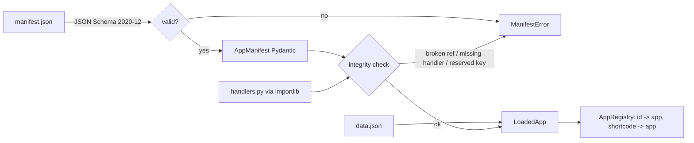

# Design: Skeleton Contract

## Overview
The contract is a JSON document per app (`manifest.json`) validated twice: structurally by
JSON Schema (`schemas/app-manifest.schema.json`), then semantically by
`core/manifest_loader.py` (graph integrity, handlers, reserved keys, unique shortcodes).
Pydantic models in `core/models.py` give the engine typed access.



## Manifest shape
```json
{
  "id": "my-app",
  "name": "My App",
  "tagline": "One sentence",
  "shortcode": "*384*9#",
  "version": "1.0.0",
  "locale": "fr-CM",
  "entryNode": "home",
  "theme": {
    "primaryColor": "#16a34a", "accentColor": "#86efac",
    "screenBg": "#06140b", "screenText": "#39ff7a",
    "bezelColor": "#1c1917", "badgeLabel": "APP 9", "icon": "*"
  },
  "navigation": {
    "backKey": "0", "homeKey": "00", "nextPageKey": "99", "sessionTimeoutSec": 180,
    "nextPageLabel": "99. Suite", "backLabel": "0. Retour",
    "invalidMessage": "Choix invalide.", "expiredMessage": "Session expiree.",
    "errorMessage": "Service indisponible."
  },
  "compression": { "abbreviations": { "Kilogramme": "kg" } },
  "quickPresets": [{ "label": "Flow 1", "inputs": "1*1" }],
  "nodes": {
    "home": { "type": "menu", "title": "My App", "options": [
      { "key": "1", "label": "Ask", "next": "ask", "set": { "topic": "a" } }
    ]},
    "ask": { "type": "input", "prompt": "Votre code:", "saveAs": "code", "next": "answer",
             "validation": { "kind": "code", "pattern": "^[A-Z0-9-]{3,12}$" }, "example": "AB-12" },
    "answer": { "type": "action", "handler": "lookup", "useAiCompression": true, "end": true }
  }
}
```

## Handler contract
```python
def lookup(context: dict, data: dict) -> str | dict:
    return {"text": "...", "end": True, "context": {"last": "..."}}
```
- Pure: no network, no file I/O, no `CON`/`END` formatting.
- Returned text may be longer than 160 characters: the compressor and paginator handle it.
- Exceptions are caught by the engine and rendered as `navigation.errorMessage` with `END`.

## Rendering assembly (shared with the gateway spec)
`body = [notice] + content + option lines + [backLabel if not entry and not end]`, then
GSM-7 normalisation, compression of `content` only, and pagination of the assembled body.

## Purity audit
`scripts/check_skeleton_purity.py`:
- `count_logical_loc(file)`: lines that are not blank, not `#` comments and not inside a module/class/function docstring (found with `ast`), matching how cloc counts Python.
- `find_leaks(file)`: case-insensitive substring search of every `FORBIDDEN_TERMS` entry on every line (code, strings and comments).
- `audit(core_dir) -> dict` reused by `/api/metrics`, the MCP server and `tests/test_skeleton_purity.py`.

## Error handling
`ManifestError(app_id, message)` is raised at load time. The server refuses to start on a
broken app, and `scripts/validate_manifests.py` reports every error without stopping at
the first one.
