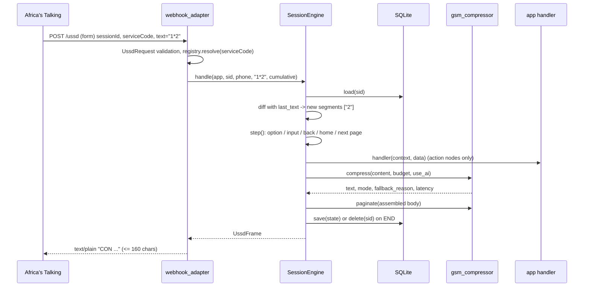
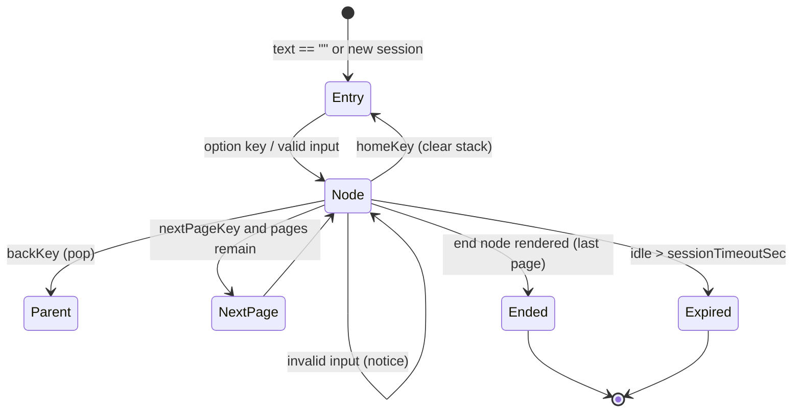
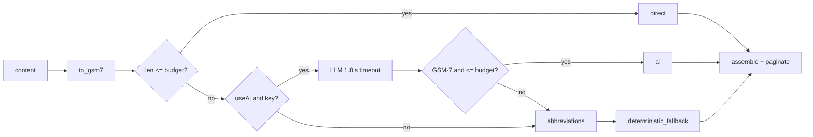

# Design: USSD Gateway

## Components
| File | Responsibility |
| --- | --- |
| `core/webhook_adapter.py` | FastAPI factory `create_app()`, content-type detection, form/JSON parity. |
| `core/session_engine.py` | `SessionStore` (SQLite) and `SessionEngine` (state machine + rendering). |
| `core/gsm_compressor.py` | `to_gsm7`, `is_gsm7`, `paginate`, async `compress` with optional LLM. |
| `main.py` | Composition root: registry, store, engine, purity audit, static frontend. |

## Request sequence (Africa's Talking)


## Session state machine


## SQLite model
```sql
CREATE TABLE IF NOT EXISTS ussd_sessions (
  session_id TEXT PRIMARY KEY,
  app_id     TEXT NOT NULL,
  state_json TEXT NOT NULL,   -- node, stack, context, pages, page_index, last_text, telemetry, end
  updated_at REAL NOT NULL
);
```
A single JSON column keeps the core small while remaining inspectable with any SQLite tool.

## Compressor pipeline

- Budget for content = `156 - len(options + footer)`, at least 40.
- `paginate` splits at the last newline in the page window if it is past half the page,
  otherwise at the last space, otherwise hard-cuts.
- LLM providers use the OpenAI-compatible `/chat/completions` endpoint; presets for
  `openai`, `groq` and `gemini`, or any `LLM_BASE_URL`.

## Testing strategy
- `tests/test_gsm_constraints.py`: transliteration, pagination of 50 to 1200 characters, LLM timeout and over-budget fallback (monkeypatched).
- `tests/test_session_engine.py`: navigation keys, replay, invalid input, expiry with an injected clock, persistence across engine instances.
- `tests/test_webhook_adapter.py`: form vs JSON parity, unknown service code, validation errors.
