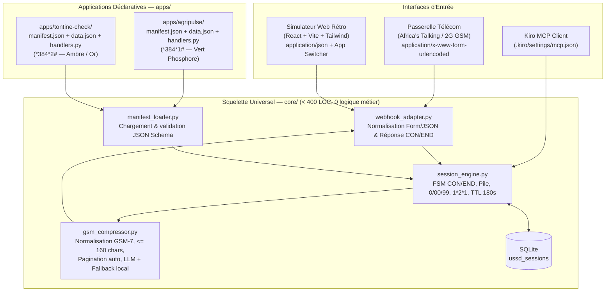

# Plan d'Implémentation Détaillé — USSD-Reborn (GhostSignal)
**Objectif :** Construire un projet gagnant pour **Kiroween 2026**, en fusionnant les deux concepts du workspace ([ussd-reborn.md](./ussd-reborn.md) et [ussd-skeleton-crew.md](./ussd-skeleton-crew.md)) dans une architecture **Kiro-native**, ultra-propre, vérifiable et prête pour la démo en 15 secondes.

---

## 1. Alignement Stratégique Kiroween 2026

### 1.1 Choix de la Catégorie & Positionnement
Les deux documents du dépôt se complètent parfaitement :
- **[ussd-skeleton-crew.md](./ussd-skeleton-crew.md)** cible la catégorie **Skeleton Crew** : un noyau léger (`< 400` lignes logiques, zéro hardcoding métier) capable de propulser **deux applications radicalement différentes** à partir de simples manifestes déclaratifs.
- **[ussd-reborn.md](./ussd-reborn.md)** apporte la force narrative **Resurrection** et l'innovation technique : ressusciter le protocole 2G GSM/USSD (`CON`/`END`, ≤ 160 caractères) avec un **compresseur sémantique IA + repli déterministe local**, un **adaptateur Africa's Talking** et un **inspecteur de trames USSD en direct**.

> **Stratégie recommandée :** Soumettre en catégorie principale **Skeleton Crew** sous le nom **USSD-Reborn (GhostSignal)** — *"The Universal USSD Skeleton Resurrecting 2G Telecom with AI"*.
> Cela satisfait **100 % des règles strictes de Skeleton Crew** (squelette < 400 LOC + 2 apps radicalement distinctes + zéro logique métier dans `core/`) tout en maximisant le score sur les trois critères Kiroween : **Potential Value/Impact**, **Implementation of Kiro**, et **Quality, Design & Creativity**.

### 1.2 Matrice de Conformité Kiroween
| Exigence Kiroween | Implémentation dans USSD-Reborn | Preuve Vérifiable |
| :--- | :--- | :--- |
| **Catégorie Skeleton Crew** | Noyau `core/` < 400 LOC logiques, 0 mot-clé métier, propulsant **AgriPulse** (`*384*1#`, Agriculture) + **Tontine-Check** (`*384*2#`, Finance communautaire) [+ **MediGuide** `*384*3#` en option] | Script `scripts/check_skeleton_purity.py` + badge live dans l'UI |
| **Dossier `.kiro/` commité** | Specs formelles (`requirements.md` EARS, `design.md`, `tasks.md`), Steering rules (`always` + `fileMatch`), Hooks `v1` JSON, et serveur MCP local dans `.kiro/settings/mcp.json` | Visible en racine du dépôt public GitHub |
| **Zéro fuite d'autres outils** | [.gitignore](./.gitignore) configuré pour ignorer tout outil IA/éditeur tiers tout en forçant `!.kiro/` | `git status --ignored` et audit pre-push |
| **Licence Open Source (OSI)** | Fichier `LICENSE` (MIT) en racine | Requis par le règlement Devpost |
| **Démo immédiate (< 15s)** | Simulateur téléphone rétro web avec sélecteur instantané **App 1 ↔ App 2**, inspecteur de trames GSM en direct et testeur `curl` Africa's Talking | Aucune carte SIM ni clé API requise (fallback déterministe intégré) |
| **Documentation & Vidéo (3 min)** | `README.md` en anglais (juges internationaux) + section dédiée *"How Kiro Built This"* + script vidéo minuté | Prêt pour soumission Devpost |

---

## 2. Points de Décision à Valider Avant Implémentation

1. **Nombre d'applications dans `apps/`** :
   - **Option A (Recommandée — Pure Skeleton Crew) :** Exactement **2 apps radicalement distinctes** (`agripulse` `*384*1#` + `tontine-check` `*384*2#`) pour une narration ultra-nette dans le format Skeleton Crew.
   - **Option B (3 apps) :** Ajouter aussi `mediguide` (`*384*3#` issu de `ussd-reborn.md`) comme 3e preuve plug-and-play.
2. **Fournisseur LLM pour le compresseur sémantique IA** :
   - Adaptateur agnostique supportant **OpenAI-compatible / Groq / Gemini / Bedrock** via variables d'environnement (`LLM_PROVIDER`, `LLM_API_KEY`), avec **mode démo local 100 % déterministe par défaut** (aucune clé requise pour que les juges testent tout instantanément).
3. **Langue de la documentation (`README.md` & `.kiro/`)** :
   - **Recommandé :** `README.md` et artefacts `.kiro/` en **anglais** (pour les juges Kiroween internationaux), avec les **menus USSD des apps en français camerounais authentique** (Douala/Yaoundé, FCFA, marchés Sandaga/Mfoundi) + sous-titres/explications en anglais dans l'inspecteur.

---

## 3. Architecture Technique Complète



### 3.1 Arborescence Cible du Dépôt

```text
USSD-Reborn/
├── .gitignore                        # [FAIT] Strictement Kiro-only, ignore tous outils tiers
├── LICENSE                           # Licence MIT (exigence OSI Kiroween)
├── README.md                         # Présentation Kiroween, Quickstart, Kiro Workflow, Architecture
├── .env.example                      # Variables d'environnement (LLM optionnel, SQLite path, port)
├── pyproject.toml                    # Dépendances Python 3.12 (FastAPI, Uvicorn, Pydantic, Pytest, JSONSchema, HTTPX)
│
├── .kiro/                            # === CŒUR KIROWEEN (100 % suivi par Git) ===
│   ├── specs/
│   │   ├── skeleton-contract/
│   │   │   ├── requirements.md       # Spécifications EARS du contrat déclaratif & séparation core/apps
│   │   │   ├── design.md             # Schéma JSON formel, contrat des compute handlers & thèmes
│   │   │   └── tasks.md              # Tâches ordonnées par dépendances
│   │   ├── ussd-gateway/
│   │   │   ├── requirements.md       # Spécifications EARS FSM CON/END, GSM-7 <= 160, fallback, webhook
│   │   │   ├── design.md             # Diagrammes de séquence & d'états, modèle SQLite, pipeline compresseur
│   │   │   └── tasks.md              # Plan d'exécution du noyau
│   │   └── retro-simulator/
│   │       ├── requirements.md       # Spécifications EARS UI rétro, switcher App 1 ↔ App 2, frame inspector
│   │       ├── design.md             # Architecture composants React + Vite, tokens CSS dynamiques
│   │       └── tasks.md              # Tâches frontend & tests E2E
│   ├── steering/
│   │   ├── product.md                # inclusion: always — Vision Cameroun 2G & Skeleton Crew
│   │   ├── tech.md                   # inclusion: always — Conventions Python/TS, stack, commandes
│   │   ├── gsm-constraints.md        # inclusion: always — Invariants CON/END, <= 160 chars, GSM-7, fallback
│   │   ├── zero-hardcoding.md        # inclusion: fileMatch (core/**/*.py) — 0 mot métier & < 400 LOC
│   │   ├── manifest-authoring.md     # inclusion: fileMatch (apps/**/*) — Guide d'écriture d'app enfant
│   │   ├── ui-design-system.md       # inclusion: fileMatch (frontend/**/*) — Direction artistique GhostSignal Halloween
│   │   └── add-ussd-app.md           # inclusion: manual (/add-ussd-app) — Playbook interactif ajout 3e app
│   ├── hooks/
│   │   ├── test-ussd-length.json     # Hook v1 PostFileSave -> pytest GSM <= 160 chars
│   │   ├── validate-manifests.json   # Hook v1 PostFileSave -> validation JSON Schema + parcours graphe
│   │   └── enforce-zero-hardcoding.json # Hook v1 PostFileSave -> audit pureté & LOC < 400 de core/
│   └── settings/
│       └── mcp.json                  # Serveur MCP local permettant à Kiro de composer & tester des sessions USSD
│
├── core/                             # === SQUELETTE UNIVERSEL (< 400 LOC logiques cumulées) ===
│   ├── __init__.py
│   ├── models.py                     # Modèles Pydantic : AppManifest, Node, Theme, UssdRequest, UssdFrame (~70 LOC)
│   ├── manifest_loader.py            # Découverte auto apps/*/manifest.json + validation JSON Schema (~65 LOC)
│   ├── gsm_compressor.py             # Normalisation ASCII/GSM-7, pagination 160c, LLM + fallback (~95 LOC)
│   ├── session_engine.py             # FSM CON/END, pile, 0/00/99, 1*2*1, SQLite, TTL 180s (~110 LOC)
│   └── webhook_adapter.py            # FastAPI : /ussd (Form + JSON), /api/apps, /api/health, /api/metrics (~55 LOC)
│                                     # TOTAL CIBLE core/ : ~350-385 LOC logiques (< 400 garanti par test CI)
│
├── schemas/
│   └── app-manifest.schema.json      # JSON Schema Draft 2020-12 officiel du Skeleton Contract
│
├── apps/                             # === APPLICATIONS ENFANTS DÉCLARATIVES ===
│   ├── agripulse/                    # App 1 : Agriculture & Marchés Vivriers Cameroun (*384*1#)
│   │   ├── manifest.json             # Arbre USSD complet + thème vert phosphore + raccourcis démo
│   │   ├── data.json                 # Prix marchés (Sandaga, Mfoundi, Bafoussam), fiches cacao, météo
│   │   └── handlers.py               # Plugins de calcul pur (lookup prix, diagnostic cacao, alerte météo)
│   └── tontine-check/                # App 2 : Finance Communautaire & Tontines (*384*2#)
│       ├── manifest.json             # Arbre USSD complet + thème ambre/or + raccourcis démo
│       ├── data.json                 # Membres démo, tours de bénéficiaires, caisse de secours, quittances
│       └── handlers.py               # Plugins de calcul pur (pénalités retard, tour, vérification quittance)
│
├── mcp_server/
│   └── ussd_mcp.py                   # Serveur MCP stdio léger (tools: list_apps, dial_ussd, audit_skeleton)
│
├── scripts/
│   ├── validate_manifests.py         # Validation JSON Schema + parcours exhaustif BFS de tous les écrans <= 160c
│   ├── check_skeleton_purity.py      # Vérification AST/regex : 0 terme métier dans core/ + LOC logiques < 400
│   └── demo_curl.sh                  # Commandes cURL Africa's Talking prêtes à exécuter
│
├── tests/
│   ├── conftest.py
│   ├── test_gsm_constraints.py       # Tests unitaires + property tests : <= 160c, GSM-7, pagination 99, CON/END
│   ├── test_session_engine.py        # Navigation, 0 (retour), 00 (accueil), 1*2*1, timeout 180s, SQLite
│   ├── test_webhook_adapter.py       # Parité form-urlencoded (Africa's Talking) vs JSON (Simulateur)
│   ├── test_skeleton_purity.py       # Garde-fou automatisé : 0 leakage métier & < 400 LOC dans core/
│   ├── test_app_agripulse.py         # Parcours E2E complets AgriPulse (*384*1#)
│   └── test_app_tontine.py           # Parcours E2E complets Tontine-Check (*384*2#)
│
└── frontend/                         # === SIMULATEUR WEB RÉTRO UNIVERSEL (React + Vite + TS) ===
    ├── index.html
    ├── package.json
    ├── tsconfig.json
    ├── vite.config.ts                # Proxy dev /ussd & /api -> FastAPI + build statique vers dist/
    ├── tailwind.config.ts
    └── src/
        ├── main.tsx
        ├── App.tsx                   # Page principale : App Switcher + Téléphone + Frame Inspector
        ├── index.css                 # Variables CSS dynamiques (thèmes apps) + effet CRT subtil
        ├── lib/
        │   ├── api.ts                # Client HTTP typé vers FastAPI (/api/apps, /ussd, /api/metrics)
        │   └── types.ts              # Types TS stricts alignés sur core/models.py
        └── components/
            ├── AppSwitcher.tsx       # Switcher instantané App 1 ↔ App 2 + badge code court & thème
            ├── RetroPhone.tsx        # Combiné rétro (écran CRT dynamique, barre signal 2G, timer 180s, clavier T9)
            ├── FrameInspector.tsx    # Inspecteur trames USSD (CON/END, xx/160c, GSM-7, LLM vs Fallback, latence)
            ├── FlowVisualizer.tsx    # Arbre de décision interactif du manifeste avec nœud actif surligné
            ├── TelecomCurlPanel.tsx  # Testeur live compatible Africa's Talking (form-urlencoded + cURL)
            └── SkeletonProofBar.tsx  # Compteur live : core/ LOC (< 400), 0 hardcoding, apps chargées
```

---

## 4. Plan d'Implémentation Étape par Étape

### Phase 1 — Fondation Kiro & Gouvernance du Dépôt (`.kiro/` + `LICENSE` + `pyproject.toml`)
**Objectif :** Poser l'intégralité de l'infrastructure Kiro **avant** d'écrire le code applicatif (vrai Spec-Driven Development).

1. **Vérifier `.gitignore` & initialiser Git** :
   - `.gitignore` déjà créé à la racine ([.gitignore](./.gitignore)).
   - Initialiser le dépôt (`git init`) et créer `LICENSE` (MIT) + `.env.example` + `pyproject.toml`.
2. **Créer les 7 Steering Docs (`.kiro/steering/`)** avec frontmatter YAML conforme Kiro (couvrant les **3 modes d'inclusion** : `always`, `fileMatch` et `manual`) :
   - `product.md` (`inclusion: always`)
   - `tech.md` (`inclusion: always`)
   - `gsm-constraints.md` (`inclusion: always`) :
     - Préfixe strict `CON ` ou `END `.
     - Plafond strict `160` caractères par écran (**trame complète avec préfixe `CON `/`END ` et pied de pagination `99. Suite` ≤ 160 caractères** pour passer les passerelles télécoms les plus strictes).
     - Alphabet GSM-7 / ASCII imprimable uniquement (translitérer `é→e`, `è→e`, `à→a`, `ç→c`, `œ→oe`, supprimer emojis).
     - Timeout LLM strict `1.8s` avec fallback déterministe local obligatoire.
   - `zero-hardcoding.md` (`inclusion: fileMatch`, `fileMatch: "core/**/*.py"`) :
     - Interdiction absolue de tout terme métier (`agri`, `cacao`, `plantain`, `manioc`, `sandaga`, `mfoundi`, `tontine`, `cotisation`, `quittance`, `fcfa`, `pharmacie`, `mediguide`, `posologie`).
     - Plafond strict `< 400` lignes logiques (hors commentaires et lignes vides) sur l'ensemble de `core/`.
   - `manifest-authoring.md` (`inclusion: fileMatch`, `fileMatch: "apps/**/*"`) :
     - Structure des nœuds (`menu`, `input`, `action`, `static`), clés réservées (`0` retour, `00` accueil, `99` suite), tokens visuels (`theme`).
   - `ui-design-system.md` (`inclusion: fileMatch`, `fileMatch: "frontend/**/*"`) :
     - Charte *GhostSignal Nocturne* (Section 5) : palettes Obsidian/Ectoplasm/Cursed Amber, polices `Syne` + `Instrument Serif` + `Space Grotesk` + `JetBrains Mono`, animations `framer-motion`, DTMF optionnel et `prefers-reduced-motion`.
   - `add-ussd-app.md` (`inclusion: manual`) :
     - Commande slash `/add-ussd-app` guidant pas à pas l'ajout d'une nouvelle application USSD déclarative sans modifier `core/`.
3. **Rédiger les 3 Specs formelles (`.kiro/specs/`)** :
   - `skeleton-contract/{requirements.md,design.md,tasks.md}` (notation EARS `WHEN ... THE SYSTEM SHALL ...`).
   - `ussd-gateway/{requirements.md,design.md,tasks.md}` (FSM complète + diagrammes Mermaid).
   - `retro-simulator/{requirements.md,design.md,tasks.md}`.
4. **Configurer les 3 Agent Hooks `v1` (`.kiro/hooks/`)** :
   - `test-ussd-length.json` (`PostFileSave` → `pytest tests/test_gsm_constraints.py -q`)
   - `validate-manifests.json` (`PostFileSave` → `python scripts/validate_manifests.py`)
   - `enforce-zero-hardcoding.json` (`PostFileSave` → `python scripts/check_skeleton_purity.py`)
5. **Configurer `.kiro/settings/mcp.json`** pointant vers `mcp_server/ussd_mcp.py`.

---

### Phase 2 — Contrat Déclaratif & Noyau Universel `core/` (< 400 LOC)
**Objectif :** Construire un squelette minimaliste, ultra-lisible, testé et 100 % agnostique du domaine.

#### 2.1 Schéma du Contrat (`schemas/app-manifest.schema.json`)
Chaque application dans `apps/<app_id>/manifest.json` déclare :
- **Métadonnées :** `id`, `name`, `tagline`, `shortcode` (ex. `*384*1#`), `version`, `locale`.
- **Thème UI dynamique (`theme`) :** `primaryColor`, `screenBg`, `screenText`, `bezelColor`, `accentColor`, `badgeLabel`, `icon`.
- **Scénarios démo rapides (`quickPresets`) :** ex. `["1*1*1", "2*1"]` pour que les juges testent un flux complet en 1 clic.
- **Configuration navigation (`navigation`) :** `backKey: "0"`, `homeKey: "00"`, `nextPageKey: "99"`, `sessionTimeoutSec: 180`.
- **Graphe d'états (`nodes`) :** dictionnaire `node_id -> NodeSpec` supportant 4 types universels :
  1. `menu` : titre + liste d'options (`key`, `label`, `next`).
  2. `input` : prompt utilisateur + validation regex/type (`numeric`, `text`, `code`) + `saveAs` (clé de contexte de session) + `next` + `errorMessage`.
  3. `action` : invoque un handler déclaratif enregistré par l'app (`handler: "get_market_prices"`), passe `(context, data)`, reçoit un texte brut + métadonnées optionnelles, puis passe dans le compresseur GSM (`useAiCompression: true|false`) et renvoie `CON` (avec `next` ou retour `0`) ou `END`.
  4. `static` : affiche un texte formaté avec interpolation `{context_var}` (`CON` ou `END`).

#### 2.2 Modules du Squelette (`core/`)
1. **`core/models.py` (~70 LOC)** :
   - Modèles Pydantic stricts : `ThemeConfig`, `MenuOption`, `NodeSpec`, `AppManifest`, `UssdRequest`, `FrameTelemetry`, `UssdResponse`.
2. **`core/manifest_loader.py` (~65 LOC)** :
   - Découvre automatiquement chaque dossier `apps/*/` contenant `manifest.json`.
   - Valide contre `schemas/app-manifest.schema.json`.
   - Charge dynamiquement `data.json` et enregistre les fonctions publiques de `handlers.py` via `importlib` (aucun import statique d'une app dans `core/`).
   - Mappe `shortcode -> app_id` et `app_id -> LoadedApp`.
3. **`core/gsm_compressor.py` (~95 LOC)** :
   - **Normalisation GSM-7 (`to_gsm7`) :** `unicodedata.normalize("NFKD")` + suppression diacritiques + remplacement caractères typographiques (`’→'`, `–→-`, `€→EUR`) + filtrage strict ASCII imprimable (`0x20-0x7E` + `\n`).
   - **Compresseur sémantique IA (`compress_semantic`) :**
     - Si `LLM_API_KEY` est configuré et `use_ai=True` et `len(text) > budget` : appel HTTP asynchrone léger avec timeout strict `1.8s` demandant une reformulation télégraphique ≤ 140 chars.
     - En cas de timeout, d'erreur réseau, d'absence de clé, ou si la sortie LLM dépasse le budget : **repli déterministe local immédiat** (abréviations de sécurité + découpage intelligent sur frontière de mots/lignes).
   - **Pagination automatique (`paginate_frame`) :**
     - Calcule le budget exact : `160 - len("CON ")` = `156` chars (ou `156 - len("\n99. Suite")` = `145` chars pour les pages intermédiaires).
     - Retourne la liste complète des pages `list[str]` + télémétrie (`raw_length`, `compressed_length`, `page_count`, `mode: "direct" | "ai" | "deterministic_fallback"`, `latency_ms`, `gsm7_valid: True`).
4. **`core/session_engine.py` (~110 LOC)** :
   - Stockage SQLite minimaliste (`sessions(session_id PK, app_id, phone_number, current_node, stack_json, context_json, pages_json, page_index, updated_at)`).
   - Gestion complète du protocole télécom :
     - **Début de session (`text == ""`)** : réinitialise la pile sur `entryNode`, renvoie le menu racine (`CON ...`).
     - **Saisie chaînée (`1*2*1`)** : supporte le format cumulatif d'Africa's Talking (`text` contient tout l'historique séparé par `*`) ET le format incrémental du simulateur (`step_input`), avec détection propre afin que les deux modes fonctionnent à l'identique.
     - **Contrôles universels :**
       - `99` : page suivante si `pages_json` a des pages restantes.
       - `0` : dépile `stack_json` et revient au nœud parent.
       - `00` : revient à `entryNode` et vide la pile.
     - **Expiration télécom :** si `now - updated_at > sessionTimeoutSec`, renvoie `END Session expiree. Recomposez le code.` et purge la session.
     - **Entrée invalide :** reste sur le nœud courant avec message concis `Choix invalide.` sans planter la session.
5. **`core/webhook_adapter.py` (~55 LOC)** :
   - Application FastAPI avec CORS configuré pour le dev Vite (et montage optionnel de `frontend/dist/` en statique pour un déploiement mono-serveur).
   - `POST /ussd` :
     - Si `Content-Type` est `application/x-www-form-urlencoded` (Africa's Talking : `sessionId`, `serviceCode`, `phoneNumber`, `text`) → retourne `PlainTextResponse("CON ..." | "END ...")` exact conforme télécom.
     - Si `Content-Type` est `application/json` (Simulateur web : `session_id`, `service_code` ou `app_id`, `phone_number`, `text`, `input_mode`) → retourne `JSONResponse` contenant `{ raw_response, prefix, body, char_count, max_chars: 160, gsm7_valid, page_index, total_pages, current_node, stack, context, telemetry }`.
   - `GET /api/apps` : liste toutes les applications découvertes avec leur `theme`, `shortcode`, `quickPresets`, et graphe `nodes` (pour le `FlowVisualizer`).
   - `GET /api/metrics` : renvoie le compteur temps réel de pureté du squelette (`core_loc`, `max_loc: 400`, `domain_leaks: 0`, `apps_loaded`, `active_sessions`).
   - `GET /api/health` : healthcheck simple.

---

### Phase 3 — Les Deux Applications Radicalement Distinctes (`apps/`)
**Objectif :** Démontrer la puissance du squelette Skeleton Crew avec deux domaines, deux palettes visuelles et deux logiques métier opposées, sans toucher à une seule ligne de `core/`.

#### 3.1 Application 1 : `apps/agripulse` (`*384*1#`) — Agriculture & Marchés Vivriers Cameroun
- **Identité visuelle :** Thème **Vert Phosphore / Terre** (`screenBg: #06140b`, `screenText: #39ff7a`, `primaryColor: #16a34a`, `accentColor: #86efac`).
- **Parcours USSD (100 % déclaratif + handlers purs) :**
  - **Accueil (`*384*1#`) :**
    ```text
    CON AgriPulse CM (*384*1#)
    1. Prix des vivres
    2. Diagnostic cacao
    3. Meteo agricole
    4. Conseil IA rapide
    ```
  - **1. Prix des vivres (`1 -> Marché -> Denrée`) :**
    - Marchés : `1. Douala (Sandaga)`, `2. Yaounde (Mfoundi)`, `3. Bafoussam`, `4. Bamenda`.
    - Produits : `1. Plantain`, `2. Manioc`, `3. Macabo`, `4. Huile de palme`, `5. Cacao (kg)`.
    - Résultat formaté ≤ 160c avec prix du jour en FCFA, tendance (`+5%`, `stable`, `-3%`) et date de relevé.
  - **2. Diagnostic Cacao (`2 -> Symptôme`) :**
    - Symptômes : `1. Cabosses noires/brunes`, `2. Piqures noires/trous`, `3. Feuilles jaunes/gonflees`.
    - Diagnostic immédiat (Pourriture brune / Capsides / Swollen Shoot) + traitement terrain prioritaire compressé en ≤ 160c (avec pagination auto `99. Suite` si détails préventifs).
  - **3. Météo Agricole (`3 -> Zone`) :**
    - Zones : `1. Littoral`, `2. Centre`, `3. Ouest`, `4. Sud-Ouest`.
    - Bulletin court 48h (pluie, humidité, fenêtre de séchage/traitement).
  - **4. Conseil IA Rapide (`4 -> Saisie libre`) :**
    - L'utilisateur tape un symptôme ou une question courte (ex. `taches blanches feuilles manioc`).
    - Passe dans le **Compresseur Sémantique IA** (LLM si clé configurée, sinon moteur de règles/connaissances local déterministe → résumé strict ≤ 160c, zéro latence perçue).

#### 3.2 Application 2 : `apps/tontine-check` (`*384*2#`) — Finance Communautaire & Tontines
- **Identité visuelle :** Thème **Ambre / Or** (`screenBg: #140e04`, `screenText: #ffb830`, `primaryColor: #d97706`, `accentColor: #fde68a`).
- **Parcours USSD (calculs financiers & vérification cryptographique légère) :**
  - **Accueil (`*384*2#`) :**
    ```text
    CON TontineCheck (*384*2#)
    1. Mon tour beneficiaire
    2. Calcul penalite retard
    3. Caisse de secours
    4. Verifier quittance
    ```
  - **1. Mon tour de bénéficiaire (`1 -> Code membre`, ex. `M01`..`M05`) :**
    - Affiche nom du membre, date du tour, rang dans le cycle, montant attendu de la cagnotte (FCFA) et statut de cotisation (`A JOUR` / `RETARD`).
  - **2. Calcul automatique des pénalités de retard (`2 -> Montant FCFA -> Jours de retard`) :**
    - Nœuds `input` chaînés avec validation numérique stricte.
    - Calcule dynamiquement : `penalite = arrondi(montant * 2% * jours)` (plafonné à 25 %), total à verser et rappel de règlement intérieur — en ≤ 160c.
  - **3. Caisse de secours (`3 -> Consultation`) :**
    - Affiche le solde global de la caisse de secours, nombre de cotisants actifs, plafond d'aide d'urgence (maladie / décès / naissance) et option `1. Eligibilite` (vérifie par code membre).
  - **4. Vérification d'un code de quittance (`4 -> Code quittance`, ex. `QT-2026-841`) :**
    - Valide l'existence et l'empreinte de contrôle d'une quittance papier/SMS : affiche date, membre, montant certifié, statut (`VALIDE` ou `INCONNU/INVALIDE`).

*(Optionnel si Option B choisie : `apps/mediguide/` `*384*3#` en thème Cyan Médical avec posologie, hydratation et pharmacies de garde Akwa/Bonapriso/Makepe — ajoutable en 1 manifeste sans aucune modification de `core/`.)*

---

### Phase 4 — Outils d'Audit, Serveur MCP Kiro & Suite de Tests Automatisés
**Objectif :** Rendre les garanties Kiroween (pureté Skeleton Crew, contraintes GSM, parité télécom) **mathématiquement prouvées** à chaque sauvegarde.

1. **`scripts/check_skeleton_purity.py`** :
   - Parse l'AST Python de tous les fichiers dans `core/`.
   - Compte exactement les **lignes logiques non vides / hors commentaires** → échoue (exit code 1) si `total_loc >= 400`.
   - Scanne tous les identifiants et littéraux chaîne contre une liste de mots-clés métier interdits → échoue si le moindre leakage est détecté.
   - Expose une fonction réutilisable par `/api/metrics` et `tests/test_skeleton_purity.py`.
2. **`scripts/validate_manifests.py`** :
   - Valide chaque `apps/*/manifest.json` contre `schemas/app-manifest.schema.json`.
   - Vérifie qu'aucun `next` ne pointe vers un nœud inexistant et qu'il n'y a pas de code court dupliqué.
   - Exécute un **parcours BFS complet** de tous les écrans statiques et menus de chaque app en vérifiant que **100 % des trames** respectent `CON `/`END `, `len <= 160` et `GSM-7`.
3. **`mcp_server/ussd_mcp.py`** :
   - Serveur MCP minimal (protocole JSON-RPC stdio) exposé dans `.kiro/settings/mcp.json` offrant 3 outils directs à Kiro :
     - `list_ussd_apps` : liste les apps découvertes, shortcodes et thèmes.
     - `simulate_ussd_flow(shortcode, inputs)` : joue une séquence complète (ex. `["", "1", "1", "1"]`) et retourne chaque trame + compteur caractères + télémétrie.
     - `audit_skeleton_compliance()` : renvoie le rapport LOC + 0 hardcoding + validation manifestes.
4. **Suite `pytest` (`tests/`)** :
   - `test_gsm_constraints.py` : tests de translittération, caractères spéciaux/emojis, troncature propre, pagination `99. Suite` sur textes de 50 à 1200 caractères, fallback sur timeout LLM simulé.
   - `test_session_engine.py` : pile de navigation, `0`, `00`, `99`, saisie chaînée `1*2*1`, entrée invalide, expiration 180s, persistance SQLite.
   - `test_webhook_adapter.py` : tests FastAPI `TestClient` vérifiant `application/x-www-form-urlencoded` (format exact Africa's Talking) ET `application/json`.
   - `test_skeleton_purity.py` : garantit `< 400` LOC et 0 terme métier dans `core/`.
   - `test_app_agripulse.py` & `test_app_tontine.py` : couverture de bout en bout des parcours utilisateurs clés.

---

### Phase 5 — Simulateur Web Rétro Universel & Inspecteur de Trames (`frontend/`)
**Objectif :** Offrir une interface visuelle mémorable ("wow effect" dès les 5 premières secondes pour les juges) qui **s'adapte intégralement aux métadonnées JSON du backend**.

1. **Architecture Frontend (React + Vite + TypeScript + Tailwind CSS)** :
   - En dev, `vite.config.ts` proxie `/api` et `/ussd` vers FastAPI (zéro problème CORS) ; en production/démo, le build statique `frontend/dist/` peut être servi directement par FastAPI sur un seul port.
   - Au chargement, `GET /api/apps` récupère dynamiquement les applications, leurs thèmes (`theme`), leurs codes courts et leurs arbres de nœuds.
   - **Zéro logique métier codée en dur dans `frontend/`** : les variables CSS (`--screen-bg`, `--screen-text`, `--brand-primary`, `--brand-accent`) basculent instantanément lors du switch **App 1 ↔ App 2**.
2. **Disposition en 3 Zones Ergonomiques :**
   - **Barre supérieure (`AppSwitcher` + `SkeletonProofBar`) :**
     - Bascule instantanée en 1 clic : **AgriPulse (`*384*1#` · Vert Phosphore)** ↔ **Tontine-Check (`*384*2#` · Ambre Or)**.
     - Indicateurs live issus de `/api/metrics` : `Core: XXX / 400 LOC` · `Domain Leaks: 0` · `GSM-7 <= 160c: Active`.
   - **Colonne Gauche (`RetroPhone`) :**
     - Coque de téléphone rétro soignée (esthétique *GhostSignal* — CRT phosphore subtil avec scanlines discrètes, LED réseau 2G clignotante, indicateur de batterie & signal GSM).
     - Écran LCD monospace affichant fidèlement la trame USSD courante + barre de statut (`CON` / `END`, compteur temps réel `118 / 160 chars`, compte à rebours session `180s`).
     - Champ de saisie + clavier numérique interactif (`0-9`, `*`, `#`, `Envoyer`, `0 Retour`, `00 Accueil`, `Raccrocher`) avec support complet du clavier physique (`Enter`, chiffres).
     - Boutons **"Quick Demo"** générés depuis `quickPresets` du manifeste (ex. *"Prix Plantain Sandaga (1\*1\*1)"*, *"Pénalité retard 5j"*) pour tester un scénario complet en un clic.
   - **Colonne Droite (Onglets d'Inspection pour les Juges) :**
     - **Onglet 1 — Live Frame Inspector (`FrameInspector`) :** Trame brute exacte (`CON ...`), jauge `xx/160` caractères, validation GSM-7, mode compression (`DIRECT` / `AI_LLM` / `DETERMINISTIC_FALLBACK`), latence ms, état de la pile `stack` et `context` SQLite, historique complet des échanges de la session.
     - **Onglet 2 — Decision Tree (`FlowVisualizer`) :** Visualisation claire de l'arbre déclaratif chargé depuis `manifest.json`, avec mise en surbrillance en temps réel du nœud courant et du chemin parcouru.
     - **Onglet 3 — Telecom Webhook (`TelecomCurlPanel`) :** Générateur de requête `POST /ussd` au format `application/x-www-form-urlencoded` (Africa's Talking) exécutable en direct depuis le navigateur + bouton copier `curl`.

---

### Phase 6 — Vérification End-to-End, Packaging & Livrables Kiroween
**Objectif :** Tout vérifier en conditions réelles et préparer une soumission Devpost irréprochable.

1. **Batterie de vérifications automatisées :**
   - `pytest -v` (100 % vert : GSM, FSM, Webhook, Pureté < 400 LOC, AgriPulse, Tontine-Check).
   - `python scripts/validate_manifests.py` (0 erreur, 100 % des écrans ≤ 160 chars).
   - `python scripts/check_skeleton_purity.py` (`core/` < 400 LOC, 0 terme métier).
   - `cd frontend && npm run build` (build production TypeScript/Vite sans erreur).
   - Test en direct serveur FastAPI + Frontend + probe `curl` au format Africa's Talking (`Content-Type: application/x-www-form-urlencoded`).
   - Vérification Git : `git status --short` confirme que `.kiro/` est bien suivi et qu'**aucun fichier/dossier d'outil tiers** n'est visible.
2. **Documentation `README.md` de niveau gagnant :**
   - Pitch clair (problème 2G Cameroun + solution Skeleton Crew).
   - Tableau de preuve Skeleton Crew (App 1 vs App 2 sur un même noyau < 400 LOC).
   - Section dédiée **How Kiro Was Used** détaillant concrètement :
     - Spec-Driven Development (`.kiro/specs/*`)
     - Steering Rules (`.kiro/steering/*`)
     - Agent Hooks (`.kiro/hooks/*`)
     - MCP Server (`.kiro/settings/mcp.json`)
   - Guide "Add a 3rd App in 3 Minutes" démontrant la réutilisabilité du squelette.
   - Guide Quickstart (Backend + Frontend + cURL Africa's Talking).
3. **Storyboard Vidéo Démo (3 minutes exactement) :**
   - `0:00 – 0:25` : Hook — La réalité 2G au Cameroun + démonstration immédiate d'AgriPulse (`*384*1#`) sur le téléphone rétro.
   - `0:25 – 1:05` : Preuve **Skeleton Crew** — Bascule en 1 clic vers **Tontine-Check (`*384*2#`)** : changement de thème, code court, arbre de décision, calcul de pénalité et vérification de quittance en direct.
   - `1:05 – 1:40` : Preuve **Resurrection / Télécom** — Live Frame Inspector (`<= 160` chars, pagination `99`, fallback déterministe) + exécution live d'un webhook `curl` Africa's Talking.
   - `1:40 – 2:35` : Preuve **Kiro** — Tour de `.kiro/` (specs EARS, steering `zero-hardcoding.md` & `gsm-constraints.md`, hook automatique qui bloque une violation en direct, et test via MCP).
   - `2:35 – 3:00` : Impact & ouverture — Comment déployer un nouveau service USSD en 1 manifeste JSON sans toucher au noyau.

---

## 5. UI/UX Design Guideline — « GhostSignal Nocturne » (Premium Halloween × Retro Hardware)

> **Règle d'or esthétique :** *Haunted Luxury Hardware* — sombre, éditorial, cinématique, tactile et hautement animé. **Zéro clipart Halloween cheap** (pas de citrouilles cartoon ni de polices kitsch). L'ambiance Halloween passe par la lumière spectrale, les textures CRT/grain argentique, la typographie éditoriale gothique-moderne et les micro-interactions nerveuses.
> Cette charte sera aussi encodée dans `.kiro/steering/ui-design-system.md` (`inclusion: fileMatch` sur `frontend/**/*`).

### 5.1 Palette de Couleurs & Thèmes Dynamiques (Skeleton Crew × Halloween)
Toute l'UI repose sur un socle **Obsidian Nocturne** invariable, tandis que la lumière spectrale primaire bascule dynamiquement via CSS Variables (`--spectral-primary`, `--spectral-glow`, `--screen-bg`, `--screen-text`) selon le manifeste de l'app active :

| Rôle | Token / Couleur | Usage |
| :--- | :--- | :--- |
| **Fond principal (Obsidian)** | `#07070B` | Toile de fond principale avec léger grain SVG (`opacity: 0.03`) |
| **Surfaces Bento / Cartes** | `#100F18 / 80%` + `backdrop-blur-xl` | Verre fumé avec bordure hairline `rgba(242, 236, 225, 0.08)` |
| **Texte principal (Bone Ivory)** | `#F2ECE1` | Titres & labels haute lisibilité (contraste WCAG AAA) |
| **Texte secondaire (Ash Mist)** | `#8F8A9E` | Métadonnées, sous-titres, labels techniques |
| **App 1 — AgriPulse (`*384*1#`)** | **Ectoplasm Phosphor** `#39FF88` / LCD `#04120A` | Lueur phosphore vert spectral (CRT vintage hanté) |
| **App 2 — Tontine-Check (`*384*2#`)** | **Cursed Amber / Gold** `#FFB224` / LCD `#140B02` | Lueur ambre bougie / or spectral |
| **Accent Kiroween transversal** | **Phantom Violet** `#9D6BFF` | Badges Kiro/Skeleton Proof, focus rings, halo subtil d'arrière-plan |
| **Alerte / `END` / Timeout** | **Blood Crimson** `#FF3B5C` | Fin de session `END`, jauge > 145 chars, erreurs de saisie |

### 5.2 Typographie Distinctive & Classy (Google Fonts)
Association **Éditorial Sombre × Hardware Télécom** (aucune police générique par défaut) :
- **Titres & Branding :** `Syne` (700/800) pour l'impact futuriste-télécom, associé à `Instrument Serif` (italique) pour les accents éditoriaux élégants (ex. *"Resurrecting 2G Signals from the Dead"*).
- **Interface & Boutons :** `Space Grotesk` (400/500/600) — géométrique, propre et moderne.
- **Écran CRT USSD, Codes Courts & Inspecteur :** `JetBrains Mono` (400/500/700) avec `font-variant-numeric: tabular-nums` pour que `*384*1#`, `118 / 160` et le timer `180s` ne sautent jamais.

### 5.3 Composants Signature & Craft Visuel
1. **Châssis Téléphone Rétro Haut de Gamme (`RetroPhone`) :**
   - Boîtier **titane sombre mat** (`linear-gradient(145deg, #191823, #0B0A11)`) avec léger biseau spéculaire 1px, haut-parleur micro-perforé, LED réseau 2G qui respire et barres de signal spectrales.
   - **Écran CRT encastré** : bordure interne profonde, scanlines ultra-fines (`opacity: 0.06`), vignette radiale douce, halo `text-shadow` phosphore qui change de couleur instantanément entre App 1 et App 2.
   - **Clavier T9 tactile 3D** : touches avec relief subtil, enfoncement physique (`scale: 0.94`) + flash néon sur la bordure au clic/clavier + **synthétiseur DTMF Web Audio API optionnel** (bouton Mute/Son — composer `*384*1#` joue de vraies tonalités télécom rétro !).
2. **Switch Spectral App 1 ↔ App 2 (`AppSwitcher`) :**
   - Sélecteur pilule en verre fumé avec indicateur glissant (`framer-motion` `layoutId`), pastille lumineuse de la couleur de l'app et code court monospace.
3. **Inspecteur Bento & Jauge 160 Caractères (`FrameInspector`) :**
   - Jauge animée `xx / 160 chars` qui passe dynamiquement du vert/ambre au rouge carmin près de la limite.
   - Badges de télémétrie nets : `CON` / `END`, `GSM-7 VALID`, `LLM` vs `LOCAL FALLBACK`, latence en `ms`.
   - Cartes avec **spotlight radial** discret au survol de la souris (`radial-gradient`).
4. **Arbre de Décision Vivant (`FlowVisualizer`) :**
   - Nœuds du manifeste JSON connectés par des traits fins ; le nœud actif pulse avec la couleur spectrale de l'app et le chemin parcouru reste illuminé.
5. **Micro-copy & Détails Halloween Élégants :**
   - Icône SVG minimaliste **GhostSignal** (onde radio 2G + silhouette spectrale géométrique trait fin `1.75px`).
   - Libellés immersifs : `2G Spectral Link · Active`, `Pure Bones: 360 / 400 LOC · 0 Hardcoding`, `Session vanishes in 172s`.
   - Toggle discret **CRT Intensity** (`Studio Clean` ↔ `Haunted CRT`) pour contrôler l'intensité des scanlines et du glow.

### 5.4 Chorégraphie d'Animations (`framer-motion` + CSS Keyframes)
- **Atmosphère d'arrière-plan :** 2 nébuleuses radiales lentes (drift 22s, opacité 12 %) qui changent de teinte lors du switch App 1 ↔ App 2 + fine ligne d'onde radio 2G (ECG spectral) dans le header.
- **Transition de switch App 1 ↔ App 2 (320ms) :** Effet rapide de **démagnétisation CRT / micro-glitch horizontal** sur l'écran du téléphone pendant la transition de couleur **Ectoplasm Green ↔ Cursed Amber**.
- **Arrivée d'une trame USSD :** Balayage phosphore vertical rapide (`180ms`) + apparition nette des lignes (`stagger: 20ms`), toujours réactif (jamais lent).
- **Entrée de page :** Stagger fluide (`y: 12 -> 0`, `opacity: 0 -> 1`, easing `[0.22, 1, 0.36, 1]`) sur le header, le téléphone et les onglets inspecteur.
- **Accessibilité obligatoire :** Respect strict de `@media (prefers-reduced-motion: reduce)` désactivant automatiquement le drift ambiant, le flicker CRT et les transitions glitch.

### 5.5 Dépendances Frontend Léger & Moderne
- `react`, `react-dom`, `vite`, `typescript`, `tailwindcss`
- `framer-motion` (transitions `layoutId`, ressort clavier T9, morphing de thèmes)
- `lucide-react` (icônes fines cohérentes 1.75px)
- Web Audio API natif (zéro dépendance externe pour les tonalités DTMF)

---

## 6. Checklist de Sécurité & Hygiène Git (Déjà Configurée)

Le fichier [.gitignore](./.gitignore) est installé à la racine du workspace :
- ✅ **`.kiro/` explicitement inclus** (`!.kiro/`, `!.kiro/**`) pour répondre aux règles Kiroween.
- ✅ **Tous les dossiers et fichiers de configuration d'outils/agents tiers ignorés** (éditeurs, assistants IA alternatifs, fichiers de règles tiers, prompts locaux).
- ✅ **Artéfacts Python, React/Vite, SQLite, `.env`, logs et fichiers OS ignorés**.
- ⚠️ **Note :** Les fichiers de notes initiaux ([ussd-reborn.md](./ussd-reborn.md) et [ussd-skeleton-crew.md](./ussd-skeleton-crew.md)) peuvent être archivés ou remplacés par le `README.md` final et `.kiro/specs/` avant le push public si tu souhaites un dépôt racine ultra-épuré.
