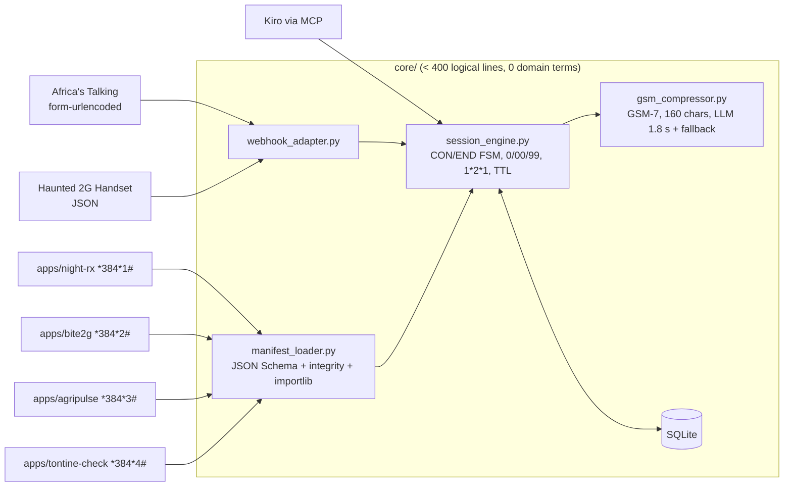

# GhostSignal · USSD-Reborn

**When the Internet dies, the 2G ghost signal survives.**  
A universal USSD skeleton that resurrects 2G push-button phones with AI — built for **Kiroween 2026** (category **Skeleton Crew**).

**Live demo:** [ussd-reborn.vercel.app](https://ussd-reborn.vercel.app) (3-act studio view) ·
**On your phone:** [ussd-reborn.vercel.app/phone](https://ussd-reborn.vercel.app/phone) (full-screen handset PWA).
No SIM card, no account, no API key.

**Through a real telecom gateway:** open the
[Africa's Talking simulator](https://simulator.africastalking.com:1517/), enter any phone number, choose
USSD and dial **`*384*69383#`**. The request goes through the Africa's Talking sandbox gateway to our
Vercel webhook (`https://ussd-reborn.vercel.app/ussd?app=night-rx`, `?app=bite2g`, `?app=agripulse` or `?app=tontine-check`),
exactly like a live operator session.

When mobile data is dead, throttled, or unaffordable, the 2G GSM/USSD signaling channel (`*xxx#`) still reaches any basic push-button phone. Traditional USSD gateways require rigid, hand-coded trees for each service. **GhostSignal** is one small, domain-agnostic engine (`core/`, strictly under 400 logical lines) that runs any number of USSD applications purely from declarative JSON manifests. Every screen it emits is a strictly valid `CON`/`END` frame of at most 160 GSM-7 characters, backed by an AI semantic compressor with an instant deterministic local fallback.

| | **SIM 1 (Featured): NightRx 24/7** | **SIM 2 (Featured): Bite2G Delivery** | **SIM 3: AgriPulse CM** | **SIM 4: Tontine-Check** |
| --- | --- | --- | --- | --- |
| **Shortcode** | `*384*1#` | `*384*2#` | `*384*3#` | `*384*4#` |
| **Domain** | 24/7 duty pharmacies, 2h urgent medicine hold, SHA-256 anti-counterfeit drug seal check, AI symptom triage | Zero-data hot meal delivery, moto rider tracker with 2-digit security PIN, AI craving matcher, voucher check | Staple food prices across 4 markets, cocoa disease triage, 48h farm weather, AI field advice | Rotating savings payout turn, capped late penalty calculator, relief fund eligibility, SHA-256 receipt check |
| **Theme** | Ectoplasm green (`#39ff88`) | Jack-o'-Lantern amber (`#ffb224`) | Spectral teal (`#2dd4bf`) | Phantom violet (`#c084fc`) |
| **Code in `core/`** | **0 lines** | **0 lines** | **0 lines** | **0 lines** |

All four applications run on the exact same 387-line skeleton. Adding a fifth takes one `manifest.json` and zero edits to `core/`.

---

## Quickstart (under 2 minutes, no SIM card or API key needed)

```bash
# 1. Backend (Python 3.12+)
python -m venv .venv
.venv/Scripts/python -m pip install -e .[dev]      # Windows
# .venv/bin/python -m pip install -e .[dev]        # macOS / Linux

# 2. Simulator build (Node 20+), served by FastAPI on the same port
cd frontend && npm install && npm run build && cd ..

# 3. Run
.venv/Scripts/python -m uvicorn main:app --port 8000
# open http://127.0.0.1:8000
```

For frontend development with hot reload, run `npm run dev` in `frontend/` and open `http://localhost:5173`. Vite proxies `/api` and `/ussd` to port 8000.

### Talk to it like a telecom operator (Africa's Talking format)
```bash
# 1. Verify a counterfeit medicine box seal on NightRx (*384*1#)
curl -X POST http://127.0.0.1:8000/ussd \
  -H 'Content-Type: application/x-www-form-urlencoded' \
  --data-urlencode 'sessionId=ATUid_rx1' --data-urlencode 'serviceCode=*384*1#' \
  --data-urlencode 'phoneNumber=+237690000000' --data-urlencode 'text=3*RX-2026-860'
# END ALERT: COUNTERFEIT CLONE!
# Code RX-2026-860 (Coartem 80/480mg (6 tabs))
# Scanned 47x across 6 cities.
# Do NOT consume.

# 2. Order 2x Poulet DG with Rider Handshake PIN on Bite2G (*384*2#)
curl -X POST http://127.0.0.1:8000/ussd \
  -H 'Content-Type: application/x-www-form-urlencoded' \
  --data-urlencode 'sessionId=ATUid_food1' --data-urlencode 'serviceCode=*384*2#' \
  --data-urlencode 'phoneNumber=+237690000000' --data-urlencode 'text=1*1*1*2*Akwa Total Gate'
# END Order ORD-767 confirmed!
# 2x Poulet DG + Ripe Plantain
# To: Akwa Total Gate (18 min)
# Total: 7 500 FCFA (MoMo/Cash)
# Rider PIN: 57
```

Run `bash scripts/demo_curl.sh` to replay complete sessions across all four apps.

---

## 3-Act Spooky Push-Button Phone Studio (`frontend/`)
- **Act I — Editorial Hero & Haunted Push-Button Handset**:
  - **SIM Cartridge Dock**: swap instantly between Featured SIM 1 (**NightRx 24/7** `*384*1#`), Featured SIM 2 (**Bite2G Delivery** `*384*2#`), and secondary SIMs (**AgriPulse CM** `*384*3#`, **Tontine-Check** `*384*4#`). All themes and presets are loaded dynamically from `GET /api/apps`.
  - **Pure Hardware Handset (`RetroPhone.tsx`)**: external 2G antenna with pulsing radio rings, recessed dot-matrix CRT screen with degauss transition, 5-way D-Pad rocker (`00 HOME / OK`), softkeys (`0 Back`, `99 More`), backlit T9 push-buttons (`1-9`, `*`, `0`, `#`), physical keyboard support, and a **Web Audio API DTMF dual-tone synthesizer**.
- **Act II — Live SS7 Frame & Manifest X-Ray Console**:
  - **Live Frame Inspector**: raw `CON`/`END` payload with visible newlines, 160-character GSM-7 gauge, compression telemetry (`DIRECT` / `AI_LLM` / `DETERMINISTIC_FALLBACK`), SQLite navigation stack, and session trace.
  - **Manifest Decision Tree**: interactive graph from `manifest.json` highlighting the current node and visited path.
  - **Africa's Talking Webhook Tester**: live `application/x-www-form-urlencoded` sender + copyable `curl`.
- **Act III — Skeleton Crew & `.kiro/` Bento Proof**:
  - Live `core/` LOC bar chart (`387 / 400 LOC`, `0 domain leaks`), 4-domain contrast matrix, and one-click copyable MCP prompts for Kiro Chat.

---

## Architecture



| `core/` file | Logical LOC | Role |
| --- | ---: | --- |
| `models.py` | 72 | Pydantic view of the contract and of frames |
| `manifest_loader.py` | 65 | Discovery, JSON Schema, graph integrity, dynamic handlers |
| `gsm_compressor.py` | 74 | GSM-7 normalisation, pagination, optional LLM with fallback |
| `session_engine.py` | 124 | State machine, cumulative/step input diffing, SQLite store |
| `webhook_adapter.py` | 52 | `/ussd` (form + JSON), `/api/apps`, `/api/metrics`, `/api/health` |
| **Total** | **387 / 400** | measured by `scripts/check_skeleton_purity.py` |

---

## How Kiro was used (`.kiro/`)
Everything is in [`.kiro/`](.kiro), committed at the repository root:

- **Spec-driven development (`.kiro/specs/`)**: three specs with EARS requirements, Mermaid designs, and dependency-ordered tasks:
  - `skeleton-contract`: manifest contract, graph integrity, and the zero-hardcoding and 400 LOC rules.
  - `ussd-gateway`: `CON`/`END` state machine, GSM-7 compressor pipeline, SQLite model, and dual webhook.
  - `retro-simulator`: haunted push-button phone UI, dynamic theme variables, and X-Ray panels.
- **Steering (`.kiro/steering/`)** covering all **3 Kiro inclusion modes**:
  - `inclusion: always`: `product.md`, `tech.md`, and `gsm-constraints.md`.
  - `inclusion: fileMatch`: `zero-hardcoding.md` (`core/**/*.py`), `manifest-authoring.md` (`apps/**/*`), and `ui-design-system.md` (`frontend/**/*`).
  - `inclusion: manual`: `add-ussd-app.md` (invoked via `/add-ussd-app`).
- **Agent hooks (`.kiro/hooks/`, v1 JSON, `PostFileSave`)**:
  - `enforce-zero-hardcoding.json`: runs `check_skeleton_purity.py` on `core/` saves.
  - `test-ussd-length.json`: runs the GSM test suite via `scripts/run_in_venv.py`.
  - `validate-manifests.json`: validates JSON Schema, graph integrity, and walks every reachable screen on `apps/` saves.
- **MCP server (`mcp_server/ussd_mcp.py`, configured in `.kiro/settings/mcp.json`)**:
  Exposes 4 tools (`list_ussd_apps`, `simulate_ussd_flow`, `compress_to_gsm7`, `audit_skeleton_compliance`) and automatically loads `.venv` site-packages if present.

### Try It Live in Kiro Chat (Copy-Paste MCP Prompts for Judges)
- *"Use MCP to dial `*384*1#` and check if medicine seal `RX-2026-860` is genuine or a counterfeit clone."*
- *"Use MCP to dial `*384*2#` with inputs `1, 1, 1, 2, Akwa Total Gate` to order 2x Poulet DG and get the Rider PIN."*
- *"Use MCP `compress_to_gsm7` to compress a 240-character thermal burn first-aid protocol into 160-character GSM-7 frames."*
- *"Run `audit_skeleton_compliance` via MCP and confirm `core/` is under 400 LOC with 0 domain leaks across all 4 apps."*

---

## Verification
```bash
python scripts/run_in_venv.py -m pytest   # full test suite: GSM, FSM, webhook parity, purity, all 4 apps
python scripts/check_skeleton_purity.py   # core/ 387 / 400 LOC, 0 domain leaks
python scripts/validate_manifests.py      # every reachable screen of all 4 apps rendered and checked
cd frontend && npm run build              # TypeScript strict + Vite production build
```

## Configuration (environment variables, all optional — see `.env.example`)
| Variable | Default | Purpose |
| --- | --- | --- |
| `USSD_DB_PATH` | `ussd_sessions.db` | SQLite session file (`:memory:` accepted) |
| `USSD_HOST` / `USSD_PORT` | `127.0.0.1` / `8000` | Used by `python main.py` |
| `USSD_CORS_ORIGINS` | `http://localhost:5173,http://127.0.0.1:5173` | Comma-separated CORS origins |
| `LLM_PROVIDER` | empty | `openai`, `groq` or `gemini` preset (OpenAI-compatible `/chat/completions`) |
| `LLM_API_KEY` | empty | Enables the AI compressor. Without it the deterministic fallback is used |
| `LLM_MODEL` / `LLM_BASE_URL` | preset | Override the model or point to any OpenAI-compatible endpoint |
| `LLM_TIMEOUT_SEC` | `1.8` | Hard deadline before the local fallback |

## License
[MIT](LICENSE)
