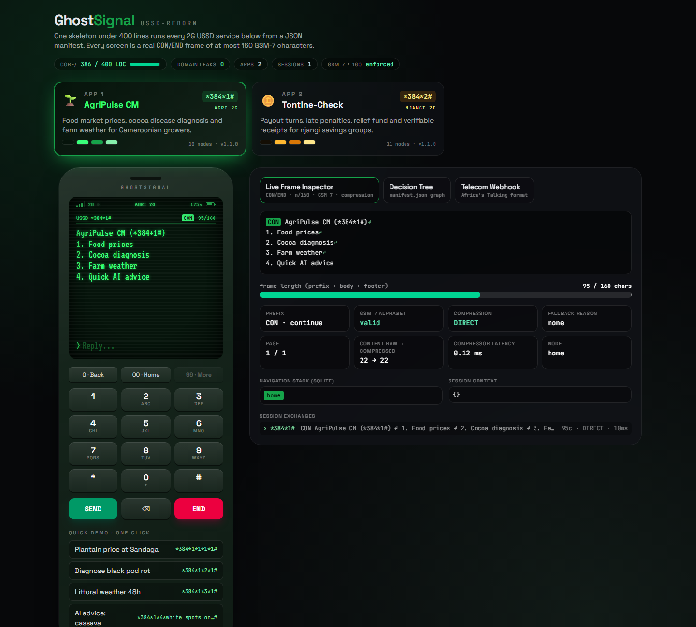
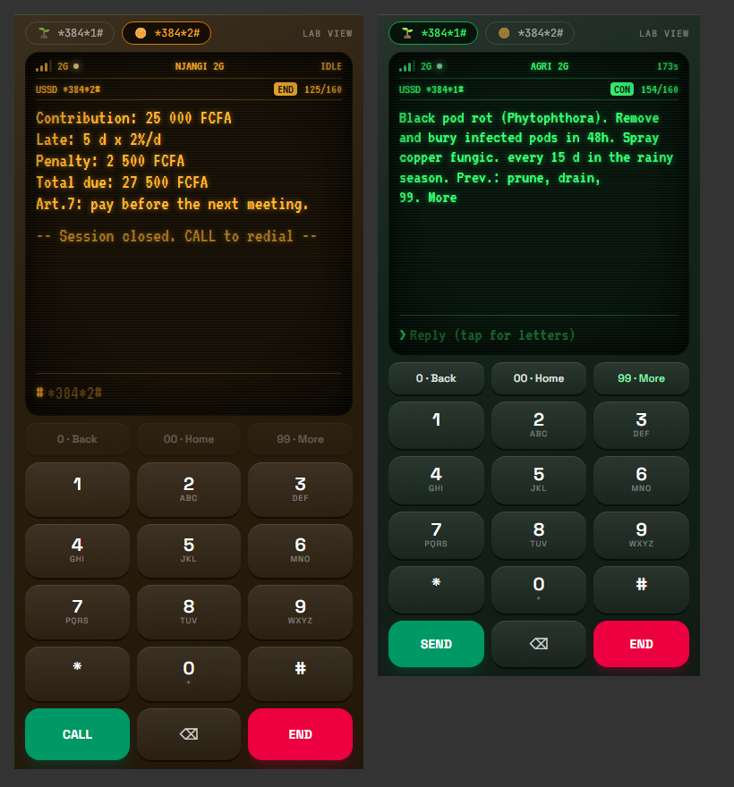
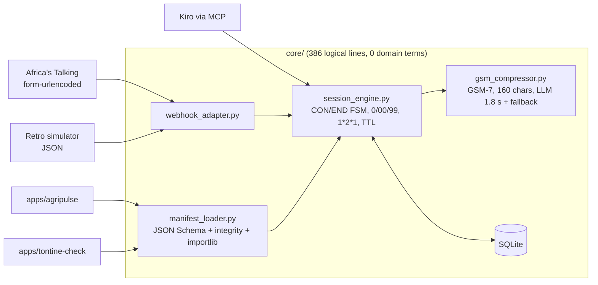

# GhostSignal · USSD-Reborn

**A universal USSD skeleton that brings 2G telecom back with AI.** Kiroween 2026, category **Skeleton Crew**.

**Live demo:** [ussd-reborn.vercel.app](https://ussd-reborn.vercel.app) (lab view) ·
**On your phone:** [ussd-reborn.vercel.app/phone](https://ussd-reborn.vercel.app/phone) (full-screen handset).
No SIM card, no account, no API key.

**Through a real telecom gateway:** open the
[Africa's Talking simulator](https://simulator.africastalking.com:1517/), enter any phone number, choose
USSD and dial **`*384*69383#`** (AgriPulse). The request goes through the Africa's Talking sandbox gateway
to our Vercel webhook, exactly like a live operator session.

In Cameroon and across sub-Saharan Africa, millions of people still use USSD (`*126#`, `#150#`) because
mobile data is expensive or unreliable outside city centres. USSD menus are usually rigid and hand-coded
per service. GhostSignal is one small, domain-agnostic engine (`core/`, under 400 logical lines) that runs
any number of USSD services from declarative JSON manifests. Every screen it emits is a valid
`CON`/`END` frame of at most 160 GSM-7 characters. An optional LLM compressor shortens long answers,
and a deterministic local fallback kicks in whenever the LLM is missing or slow.



| | App 1: **AgriPulse CM** | App 2: **Tontine-Check** |
| --- | --- | --- |
| Shortcode | `*384*1#` | `*384*2#` |
| Domain | Agriculture: food market prices, cocoa disease diagnosis, farm weather, quick AI advice | Community finance: payout turn, late penalty calculator, relief fund, receipt verification |
| Logic | Lookups across 4 markets x 5 products, keyword scoring over a local knowledge base, AI compression | Numeric inputs, capped penalty maths, eligibility rules, SHA-256 receipt fingerprints |
| Theme | Phosphor green | Amber / gold |
| Code in `core/` | **0 lines** | **0 lines** |

Both apps run on the same skeleton. Neither one needs a single line in `core/`.

Both apps speak Cameroonian English (`en-CM`; Cameroon is officially bilingual) with real local
references: Douala Sandaga and Yaounde Mfoundi markets, FCFA, njangi savings groups. Every user-facing
string, including the `99. More`, `0. Back` and `Invalid choice.` labels, lives in the manifests.
A French (`fr-CM`) version of an app is a copy of its `apps/` folder with a new id, shortcode and
translated text, with no change to `core/`.

## Quickstart (about 2 minutes, no SIM card or API key needed)

```bash
# 1. Backend (Python 3.12+)
python -m venv .venv
.venv/Scripts/python -m pip install -e .[dev]      # Windows
# .venv/bin/python -m pip install -e .[dev]        # macOS / Linux

# 2. Simulator build (Node 20.19+ or 22.12+), served by FastAPI on the same port
cd frontend && npm install && npm run build && cd ..

# 3. Run
.venv/Scripts/python -m uvicorn main:app --port 8000
# open http://127.0.0.1:8000
```

For frontend development with hot reload, run `npm run dev` in `frontend/` and open
`http://localhost:5173`. Vite proxies `/api` and `/ussd` to port 8000.

### With Docker (one command)
```bash
docker build -t ghostsignal . && docker run --rm -p 8000:8000 ghostsignal
# open http://127.0.0.1:8000
```
The image builds the simulator, then serves the webhook, the API and the UI on a single port.
It runs as a non-root user, and SQLite sessions live in `/tmp` (demo data, reset on restart).

### Deploy a public demo on Vercel
[](https://vercel.com/new/clone?repository-url=https://github.com/ArthurNsongan/USSD-Reborn)

`vercel.json` declares two [Vercel Services](https://vercel.com/docs/services) in one project:
`app` (FastAPI, `main:app`, one Vercel Function) receives `/ussd` and `/api/*`, and `frontend` (the Vite
simulator, served from the CDN) receives every other path. Both share one domain, so the simulator calls
the API without CORS. No secret is needed.

Serverless instances do not share memory or disk, so a USSD session can land on an instance that has
never seen it. That is fine by design: like Africa's Talking, the simulator always sends the cumulative
input history (`1*2*1`), and the engine rebuilds a missing session by replaying it. A test checks that
rebuilt frames are byte-identical (`test_lost_session_is_rebuilt_from_cumulative_text`). The SQLite store
then acts as a per-instance cache in the temp directory. Two limits remain on serverless: the 180 s
expiry is only enforced by the instance that holds the session, and the "Sessions" counter is per instance.

Once deployed, `https://<your-app>.vercel.app/ussd` works directly as an Africa's Talking USSD callback URL.
The `Dockerfile` remains available for container hosts (Railway, Fly.io, Render).

### Talk to it like a telecom operator
```bash
curl -X POST http://127.0.0.1:8000/ussd \
  -H 'Content-Type: application/x-www-form-urlencoded' \
  --data-urlencode 'sessionId=ATUid_1' --data-urlencode 'serviceCode=*384*2#' \
  --data-urlencode 'phoneNumber=+237690000000' --data-urlencode 'text=2*25000*5'
# END Contribution: 25 000 FCFA
# Late: 5 d x 2%/d
# Penalty: 2 500 FCFA
# Total due: 27 500 FCFA
# Art.7: pay before the next meeting.
```
`bash scripts/demo_curl.sh` replays complete sessions. To go live, point an Africa's Talking USSD
channel callback at `https://<your-host>/ussd`.

## What the simulator shows
- **App switcher**: one click swaps the shortcode, theme, quick demos and decision tree. All of it comes from `GET /api/apps`, so nothing app-specific is hardcoded in `frontend/src`.
- **Retro phone**: LCD with scanlines, 2G LED, a `n/160` counter, a 180 s session countdown and a T9 keypad. You can use the physical keyboard, and direct dial works too (`*384*1*1*1#`).
- **Live Frame Inspector**: shows the raw frame with visible newlines, a 160-character gauge, the GSM-7 check, the compression mode (`DIRECT` / `AI_LLM` / `DETERMINISTIC_FALLBACK`) and the fallback reason, plus the SQLite stack and context and the full exchange history.
- **Decision Tree**: the manifest graph, with the current node and visited path highlighted.
- **Telecom Webhook**: sends the exact Africa's Talking form request from the browser and gives you a copyable `curl`.
- **Skeleton proof bar**: `core/` LOC against 400, domain-term leaks, loaded apps and active sessions, computed live by the audit script.

## Phone mode (`/phone`)



Open [`/phone`](https://ussd-reborn.vercel.app/phone) on Android or iOS for a full-viewport 2G handset:
LCD, keypad with haptic feedback, `0` / `00` / `99` soft keys and a service picker. Type `*384*2#` and
press CALL like on a real phone, or tap the input field for letters (member codes, receipt codes, AI questions).

- **Android (Chrome):** the first tap switches to real full screen. *Install app* / *Add to Home screen* opens it full screen every time.
- **iPhone (Safari):** iOS does not allow web pages to go full screen in the browser. Use *Share > Add to Home Screen*: launched from the icon, it runs without browser bars (a one-time hint explains this).
- **Deep links:** `/phone?app=tontine-check` picks a service, `/phone?dial=*384*1*1*1%23` dials a full shortcut.

## Test on a real phone over GSM

The simulator speaks exactly the Africa's Talking protocol, so the same deployment answers a real USSD
gateway. Real dialing needs a shortcode provisioned by an aggregator on each operator:

- **Africa's Talking sandbox (free, works from anywhere):** our sandbox channel `*384*69383#` calls
  `https://ussd-reborn.vercel.app/ussd?app=agripulse`; dial it in the
  [web simulator](https://simulator.africastalking.com:1517/). To reproduce it with your own account,
  add a USSD channel with that callback URL (or `?app=tontine-check`). `?app=` maps the code the sandbox
  assigns to one of the apps.
- **Live codes:** Africa's Talking publishes live USSD pricing for East African operators (Kenya, Uganda,
  Tanzania, among others). We did not find public live USSD coverage for Cameroon (MTN, Orange). A
  `*xxx#` code dialable in Douala or Yaounde has to be obtained through an operator or a local aggregator,
  then pointed at `/ussd` with the same callback format.

## Architecture



| `core/` file | Logical LOC | Role |
| --- | ---: | --- |
| `models.py` | 72 | Pydantic view of the contract and of frames |
| `manifest_loader.py` | 65 | Discovery, JSON Schema, graph integrity, dynamic handlers |
| `gsm_compressor.py` | 74 | GSM-7 normalisation, pagination, optional LLM with fallback |
| `session_engine.py` | 124 | State machine, cumulative/step input diffing, SQLite store |
| `webhook_adapter.py` | 51 | `/ussd` (form + JSON), `/api/apps`, `/api/metrics`, `/api/health` |
| **Total** | **386 / 400** | measured by `scripts/check_skeleton_purity.py` |

A logical line is not blank, not a comment, and not inside a docstring, which is how cloc counts Python.

### Protocol guarantees
- The prefix is always `CON ` or `END `, and the full frame is at most 160 characters including the `99. More` footer.
- Only the GSM-7 basic alphabet goes out. Accents, ligatures, typographic quotes, `€` and emojis are transliterated or dropped. Escape characters (`[ ] { } \ ^ ~ |`) are never emitted because each one costs two septets.
- `0` goes back, `00` goes home, `99` shows the next page. Invalid input re-renders the screen with a short notice.
- Africa's Talking sends the cumulative text (`1*2*1`). The engine diffs it against the previous request and replays it when the history diverges, so cumulative and step-by-step input give byte-identical frames (this is tested).
- Sessions expire after `sessionTimeoutSec` (180 s) and end with an `END` frame.

## Add a third app in 3 minutes
1. Create `apps/my-app/manifest.json` (`id` must equal the folder name, `shortcode` must be unique):
   ```json
   {
     "id": "my-app", "name": "MyApp", "tagline": "...", "shortcode": "*384*3#",
     "version": "1.0.0", "locale": "en-CM", "entryNode": "home",
     "theme": { "primaryColor": "#0891b2", "accentColor": "#a5f3fc", "screenBg": "#03141a",
                "screenText": "#5eead4", "bezelColor": "#0f1f24", "badgeLabel": "APP 3", "icon": "💧" },
     "nodes": {
       "home": { "type": "menu", "title": "MyApp", "options": [{ "key": "1", "label": "Info", "next": "info" }] },
       "info": { "type": "static", "text": "Drink 2L of water a day.", "end": true }
     }
   }
   ```
2. Optionally add `data.json` and `handlers.py` with pure functions `def name(context, data) -> str | dict`.
3. Run `python scripts/validate_manifests.py` and restart the server. The app shows up in the switcher, the webhook and MCP.

The contract is in `schemas/app-manifest.schema.json` and `.kiro/steering/manifest-authoring.md`.

## How Kiro was used
Everything is in [`.kiro/`](.kiro), which is committed.

- **Spec-driven development** (`.kiro/specs/`): three specs, each with EARS requirements, a design with Mermaid diagrams, and tasks.
  - `skeleton-contract`: the manifest contract, graph integrity, and the zero-hardcoding and 400 LOC rules.
  - `ussd-gateway`: the CON/END state machine, the GSM compressor pipeline, the SQLite model and the webhook.
  - `retro-simulator`: the UI, theming and inspection panels.
- **Steering** (`.kiro/steering/`):
  - Always included: `product.md`, `tech.md` and `gsm-constraints.md` (the protocol invariants).
  - Included by file match: `zero-hardcoding.md` loads on `core/**/*.py` so Kiro is reminded of the budget whenever it edits the skeleton, and `manifest-authoring.md` loads on `apps/**/*`.
- **Agent hooks** (`.kiro/hooks/`, v1 JSON, `PostFileSave`):
  - `enforce-zero-hardcoding`: runs `check_skeleton_purity.py` on `core/` saves.
  - `test-ussd-length`: runs the GSM test suite.
  - `validate-manifests`: runs the schema check, integrity check and exhaustive screen walk on `apps/` saves.
- **MCP server** (`mcp_server/ussd_mcp.py`, stdio): exposes `list_ussd_apps`, `simulate_ussd_flow` and `audit_skeleton_compliance`, so Kiro can dial the services and audit the skeleton from chat. It is registered in the committed
`.kiro/settings/mcp.json`, so opening the repository in Kiro is enough:
  ```json
  {
    "mcpServers": {
      "ussd-reborn": {
        "command": "python",
        "args": ["mcp_server/ussd_mcp.py"],
        "disabled": false,
        "autoApprove": ["list_ussd_apps", "simulate_ussd_flow", "audit_skeleton_compliance"]
      }
    }
  }
  ```

Hooks and MCP call plain `python` and still use the project `.venv` when it exists, so they work without
activating it. `scripts/run_in_venv.py` relaunches a command with the venv interpreter (used by the
pytest hook). `scripts/check_skeleton_purity.py` uses only the standard library.
`scripts/validate_manifests.py` and `mcp_server/ussd_mcp.py` add the `.venv` site-packages to their path.

## Verification
```bash
python -m pytest                          # 117 tests: GSM, state machine, webhook parity, purity, both apps
python scripts/check_skeleton_purity.py   # core/ 386 / 400 LOC, 0 domain leaks
python scripts/validate_manifests.py      # every reachable screen of every app rendered and checked
cd frontend && npm run build              # TypeScript strict + Vite production build
```

## Configuration (environment variables, all optional)
| Variable | Default | Purpose |
| --- | --- | --- |
| `USSD_DB_PATH` | `ussd_sessions.db` | SQLite session file (`:memory:` accepted) |
| `USSD_HOST` / `USSD_PORT` | `127.0.0.1` / `8000` | Used by `python main.py` |
| `USSD_CORS_ORIGINS` | `http://localhost:5173,http://127.0.0.1:5173` | Comma-separated CORS origins |
| `LLM_PROVIDER` | empty | `openai`, `groq` or `gemini` preset (OpenAI-compatible `/chat/completions`) |
| `LLM_API_KEY` | empty | Enables the AI compressor. Without it the deterministic fallback is used |
| `LLM_MODEL` / `LLM_BASE_URL` | preset | Override the model or point to any OpenAI-compatible endpoint |
| `LLM_TIMEOUT_SEC` | `1.8` | Hard deadline before the local fallback |

Only nodes with `useAiCompression: true` (AgriPulse "Quick AI advice") ever call the LLM, and only
when their text does not fit the screen.

## Data disclaimer
Market prices, weather bulletins, members and receipts are fictional demo data. Agronomic advice is
generic guidance, not a substitute for an agricultural extension officer.

## License
[MIT](LICENSE)
